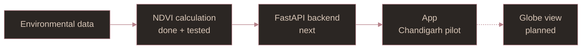

<p align="center">
  
</p>

---

## 🌍 Featured Project: EarthSignal

> Environmental intelligence for Indian cities, starting with a pilot in **Chandigarh**.

<p align="center">
  <a href="https://github.com/taniyapaliwal-png/EarthSignal">
    
  </a>
</p>

**Status:** in progress, built step by step and committed as I go.

- 🌿 Vegetation health measured with an NDVI function (tested)
- ⚙️ FastAPI backend is the next milestone
- 🌐 Long-term vision: an app with a globe-style view



---

## 🎀 About Me

```javascript
const taniya = {
  name: "Taniya",
  role: "Aspiring Developer",
  location: "India",
  funFact: "Former NCC candidate",

  mainProject: "EarthSignal",

  alsoBuilding: [
    "Netflix Data Analysis",
    "Game of Life"
  ],

  learning: [
    "Machine Learning",
    "Data Structures & Algorithms",
    "C++"
  ],

  askMeAbout: ["C++", "DSA problems"],
  motto: "Progress, not perfection. One commit at a time."
};
```

## 🛠️ Tech Stack

<p>
  
  
  
  
  
  
  
  
</p>

## 📊 GitHub Activity

<p align="center">
  
  
</p>

<p align="center">
  
</p>

## 🤎 Connect

<p>
  <a href="https://www.linkedin.com/in/taniya-529580374/"></a>
  <a href="https://x.com/taniya_paliwal"></a>
  <a href="https://instagram.com/taniya._.25"></a>
</p>


